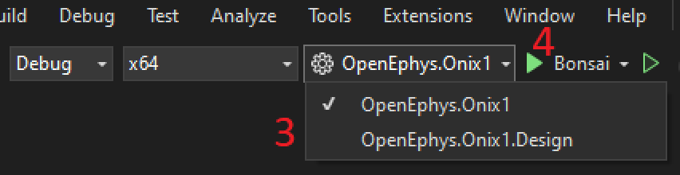
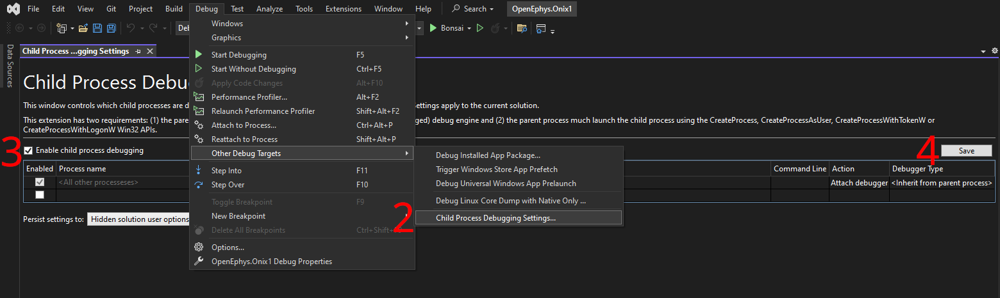
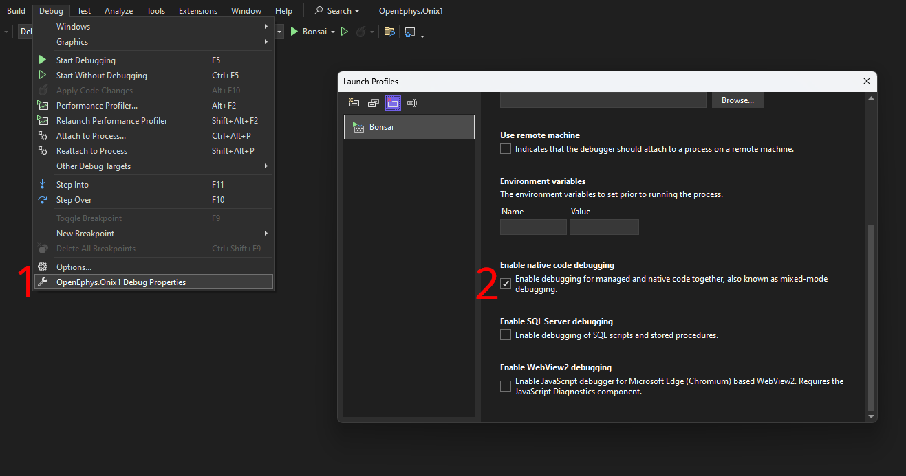
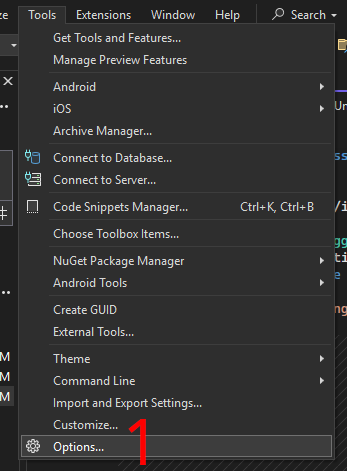
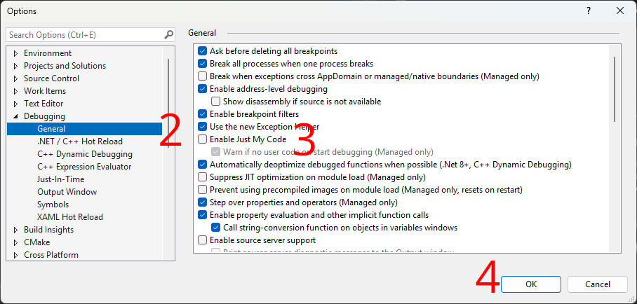
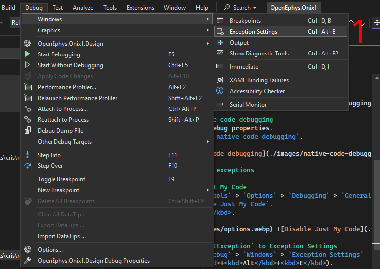
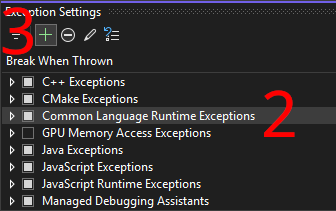
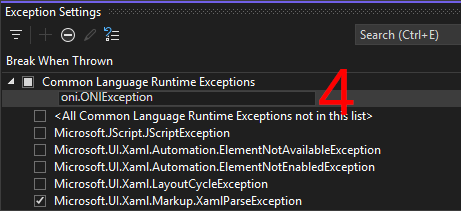
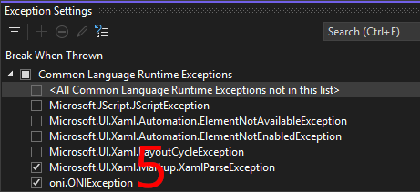

# Onix1 Bonsai Library
[Bonsai](https://bonsai-rx.org/) library for the [Open Ephys Onix
Acquisition System](https://open-ephys.github.io/onix-docs).

- Open Ephys store: https://open-ephys.org/onix
- Library documentation: https://open-ephys.github.io/bonsai-onix1-docs
- Hardware documentation: https://open-ephys.github.io/onix-docs

### Run in Visual Studio
1. Double click the `Setup.cmd` file in the `.bonsai` folder. This will install a
   portable version of Bonsai in the folder along with its required packages.
1. Open `OpenEphys.Onix1.sln` in Visual Studio (Community Edition is fine).
1. Select which project to compile and run Bonsai against.
   - `OpenEphys.Onix1`: core library (No GUI elements will be loaded)
   - `OpenEphys.Onix1.Design`: core library and GUI elements
1. Press the Play button to
   - Compile the library selected in step 3
   - Run the Bonsai application installed in step 1
   - Instruct Bonsai to load the compiled library

### Enable debugging

#### Enable child process debugging
1. Download and install [Microsoft Child Process Debugging Power Tool 2022](https://marketplace.visualstudio.com/items?itemName=vsdbgplat.MicrosoftChildProcessDebuggingPowerTool2022).
1. Navigate to child process debugging settings.
1. Check `Enable child process debugging`.
1. Click <kbd>Save</kbd>.

#### Enable native code debugging
1.  Navigate to debug properties.
1.  Check `Enable native code debugging`.

#### Break on ONI exceptions

##### Disable Just My Code
1. Navigate to `Tools` > `Options`.
1. Navigate to  `Debugging` > `General`.
1. Uncheck `Enable Just My Code`.
1. Click <kbd>OK</kbd>.

 

##### Add `oni.ONIException` to Exception Settings
1. Navigate to `Debug` > `Windows` > `Exception Settings`
   (<kbd>Ctrl</kbd>+<kbd>Alt</kbd>+<kbd>E</kbd>).
1. Select the `Common Language Runtime Exceptions` row.
1. Click the green <kbd>+</kbd> button to add an exception to the selected
   category.
1. Type `oni.ONIException` and press <kbd>Enter</kbd>.
1. Make sure the checkbox next to `oni.ONIException` is checked.

